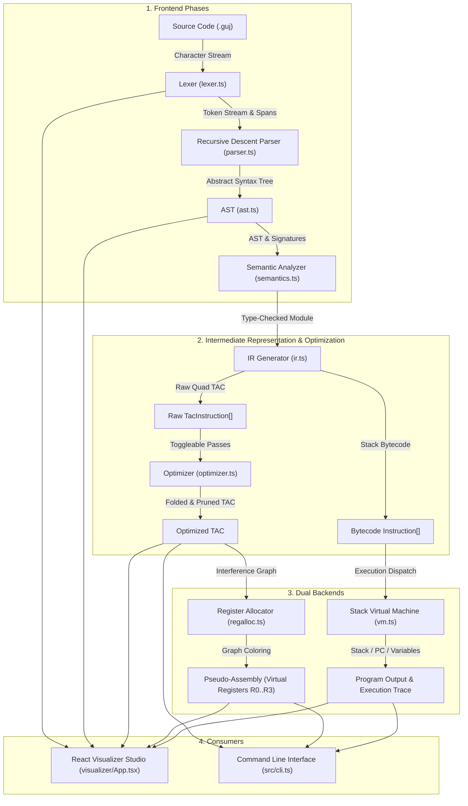
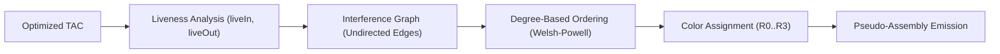

# Working Mechanism of GujLang Compiler & Visualizer Studio

This document provides a comprehensive, end-to-end technical explanation of how the **GujLang** codebase works. It details the internal architecture, data structures, phase-by-phase transformations, execution models, and integration between the TypeScript compiler core and the React visualizer studio.

---

## 1. Architectural Overview & System Design

GujLang is an educational imperative programming language featuring a phonetic Gujarati keyword set alongside standard English keywords. The system is designed as a **zero-dependency, purely client-executable compiler pipeline**. It does not rely on any remote backend or runtime server; the entire compiler, intermediate code generator, optimizer, register allocator, and stack virtual machine run directly in the browser (or in Node.js/Bun for the CLI).

### 1.1 Complete Compilation Pipeline



---

## 2. Directory Structure & File Map

| Path | Primary Responsibility |
|---|---|
| [src/ast.ts](file:///c:/Harsh/Privet%20Folder/Project/PCD/src/ast.ts) | Type definitions for AST nodes (`Expr`, `Stmt`, `FunctionDecl`, `Module`, `Span`). |
| [src/diagnostics.ts](file:///c:/Harsh/Privet%20Folder/Project/PCD/src/diagnostics.ts) | Unified bilingual error diagnostic structure (`Diagnostic`, `CompileFailure`). |
| [src/lexer.ts](file:///c:/Harsh/Privet%20Folder/Project/PCD/src/lexer.ts) | Table-driven dual-language tokenizer producing position-tracked tokens. |
| [src/parser.ts](file:///c:/Harsh/Privet%20Folder/Project/PCD/src/parser.ts) | Recursive-descent parser implementing the EBNF grammar with panic-mode recovery. |
| [src/semantics.ts](file:///c:/Harsh/Privet%20Folder/Project/PCD/src/semantics.ts) | Static type inference, symbol table tracking, and path return analysis. |
| [src/ir.ts](file:///c:/Harsh/Privet%20Folder/Project/PCD/src/ir.ts) | Lowers AST into Stack Bytecode (`Instruction[]`) and Three-Address Code (`TacInstruction[]`). |
| [src/optimizer.ts](file:///c:/Harsh/Privet%20Folder/Project/PCD/src/optimizer.ts) | Basic-block constant folding and backward liveness dead-code elimination. |
| [src/regalloc.ts](file:///c:/Harsh/Privet%20Folder/Project/PCD/src/regalloc.ts) | Interference graph generation and degree-ordered graph coloring register allocation. |
| [src/vm.ts](file:///c:/Harsh/Privet%20Folder/Project/PCD/src/vm.ts) | Stack bytecode interpreter with call frames, instruction caps, and state tracing. |
| [src/compiler.ts](file:///c:/Harsh/Privet%20Folder/Project/PCD/src/compiler.ts) | Main orchestrator coordinating lexing, parsing, analysis, IR gen, and execution. |
| [src/cli.ts](file:///c:/Harsh/Privet%20Folder/Project/PCD/src/cli.ts) | Node/Bun CLI binary entry point. |
| [visualizer/App.tsx](file:///c:/Harsh/Privet%20Folder/Project/PCD/visualizer/App.tsx) | Main React UI providing interactive phase-by-phase tabs, VM stepping, and docs. |
| [visualizer/GujLangEditor.tsx](file:///c:/Harsh/Privet%20Folder/Project/PCD/visualizer/GujLangEditor.tsx) | CodeMirror 6 code editor with custom stream highlighting and theme. |

---

## 3. Phase-by-Phase Working Mechanism

### Phase 1: Lexical Analysis ([src/lexer.ts](file:///c:/Harsh/Privet%20Folder/Project/PCD/src/lexer.ts))

The lexer scans the raw UTF-8 source string sequentially using a single pointer `i` alongside `line` and `column` tracking.

```
Source Code ──> [ Character Scanner (advance) ] ──> [ Match Rule ] ──> [ Emit Token ]
                        │
                        ├─ Whitespace / Comments (#, //) ──> Skip
                        ├─ Letters / Identifiers ──> Keyword Table / Multi-word Check
                        ├─ Digits / Decimals ──> INT / FLOAT Literal
                        ├─ Quotes ("", '') ──> STRING Literal
                        └─ Symbols (==, ->, +, ...) ──> Punctuation / Operator
```

#### Core Mechanisms
1. **Table-Driven Dual-Language Lookup:**  
   The `aliases` map associates both English and phonetic Gujarati spellings to standard token types:
   * `rakh` / `let` / `var` $\rightarrow$ `DECLARE`
   * `jo` / `if` $\rightarrow$ `IF`
   * `kar` / `do` $\rightarrow$ `DO`
   * `bas` / `end` $\rightarrow$ `END`
   * `sacu` / `true` $\rightarrow$ `TRUE`
   * `khotu` / `false` $\rightarrow$ `FALSE`
   * `ane` / `and` $\rightarrow$ `AND`
2. **Lookahead Multi-word Phrase Matching:**  
   Phrases consisting of multiple words are resolved via lookahead regexes before alias fallback:
   * `lower === "pachu" && /^\s+aap\b/i` consumes the subsequent `aap` and emits a single `RETURN` token.
   * `lower === "nahi" && /^\s+to\b/i` consumes the subsequent `to` and emits a single `ELSE` token.
3. **Source Span Precision:**  
   Every emitted `Token` encapsulates a `Span`:
   ```typescript
   export type Span = {
     start: number;     // 0-indexed character offset
     end: number;
     line: number;      // 1-indexed line number
     column: number;    // 1-indexed column number
     endLine: number;
     endColumn: number;
   };
   ```
4. **Panic-Tolerant Lexing:**  
   Unterminated strings (`L001`), invalid numeric representations (`L002`), or illegal characters (`L000`) emit a bilingual `Diagnostic` while advancing the pointer so the scanner tokenizes the rest of the file without crashing.

---

### Phase 2: Syntax Analysis ([src/parser.ts](file:///c:/Harsh/Privet%20Folder/Project/PCD/src/parser.ts))

The parser takes the array of `Token`s and constructs an Abstract Syntax Tree (`Module`) via recursive descent according to the EBNF grammar defined in [GRAMMAR.md](file:///c:/Harsh/Privet%20Folder/Project/PCD/GRAMMAR.md).

#### 1. Precedence Climbing for Expressions
Expressions are parsed from lowest precedence to highest:
$$\text{expression (OR)} \rightarrow \text{andExpr (AND)} \rightarrow \text{notExpr (NOT)} \rightarrow \text{comparison} \rightarrow \text{add (+, -)} \rightarrow \text{mul (*, /)} \rightarrow \text{unary (-)} \rightarrow \text{primary}$$

* **Non-Associative Comparisons:** Comparisons (`>`, `<`, `>=`, `<=`, `==`, `!=`) reject chaining. Writing `a < b < c` immediately throws `ParseIssue("Chained comparisons are not allowed")`.
* **Primary Expressions:** Primary values include integer/float numbers, boolean literals (`TRUE`/`FALSE`), identifier variables, function calls (`name(args...)`), and parenthesized sub-expressions `(expr)`.

#### 2. Module & Function Splitting
The top-level parser processes statements and function declarations into a unified AST module:
```typescript
export type Module = {
  kind: "module";
  functions: FunctionDecl[]; // 'kaam' / 'function' declarations
  program: Program;          // Top-level statements
};
```
Functions are top-level only; nested functions are rejected during block parsing.

#### 3. Panic-Mode Error Recovery
When a `ParseIssue` is encountered:
1. A parser diagnostic (`P001`) is recorded with the token's span.
2. The parser enters `recover()`: it skips tokens until it finds a statement start token (`DECLARE`, `IF`, `WHILE`, `PRINT`, `RETURN`, `BREAK`, `CONTINUE`, `FUNCTION`, or `IDENT =`) or block boundaries (`END`, `EOF`).
3. The synchronization boundary allows subsequent statements in the block to be parsed, surfacing multiple syntax errors in a single compiler run.

---

### Phase 3: Semantic Analysis & Type System ([src/semantics.ts](file:///c:/Harsh/Privet%20Folder/Project/PCD/src/semantics.ts))

Semantic analysis verifies static program correctness, maintains scoping rules, and assigns static types before code generation.

#### 1. Function Signature Hoisting
Before statement checking, all functions in `module.functions` are scanned. Their names, parameter counts, parameter types, and return types are stored in a `signatures: Map<string, FunctionDecl>`. This enables forward referencing (a function can be called before its textual declaration).

#### 2. Scope Isolation Model
* **Global Scope:** Top-level declarations (`rakh x = 5`) populate `globals: Map<string, ValueType>`.
* **Function-Local Frame:** Functions execute in complete isolation. When checking `fn.body`, a fresh `env` map is populated exclusively with `fn.parameters`.
* **No Closure / Global Access:** Functions cannot read or write global variables or caller locals. Accessing an outer variable from within a function emits `S001: Undeclared variable 'x' in fn`.

#### 3. Static Type Rules
The language supports three primitive value types: `int`, `float`, and `bool` (with `string` reserved exclusively for direct `bolo` printing).

| Operation | Permitted Types | Resulting Type | Notes |
|---|---|---|---|
| `+`, `-`, `*` | `int`, `float` | `int` or `float` | Promotes to `float` if any operand is `float` |
| `/` | `int`, `float` | `float` | Always produces `float` |
| `ane`, `athva` | `bool` | `bool` | Requires boolean operands |
| `nathi`, Unary `-` | `bool` (for `nathi`), `int`/`float` (for `-`) | Same as operand | Rejects type mismatches |
| `<`, `>`, `<=`, `>=` | `int`, `float` | `bool` | Numeric operands only |
| `==`, `!=` | Matching types | `bool` | `int == int`, `float == float`, `bool == bool` |
| Assignment (`=`) | Exact match | $T$ | Strict: cannot assign `int` to `float` or vice-versa |

#### 4. Path Return Analysis (`alwaysReturns`)
Functions are statically verified to guarantee that a value of the declared return type is returned along **every possible execution path**:
* An explicit `return` statement returns `true`.
* An `if` statement satisfies the condition only if it has an `elseBlock` and **both** branches satisfy `alwaysReturns`.
* Loops alone never satisfy `alwaysReturns` because a loop body might execute zero times.
* Failure to return on all paths emits `S019: Function 'fn' must return T on every path`.

---

### Phase 4: Intermediate Code Generation ([src/ir.ts](file:///c:/Harsh/Privet%20Folder/Project/PCD/src/ir.ts))

GujLang generates two distinct intermediate representations from the type-checked AST:

#### 1. Stack Bytecode (`Instruction[]`)
A compact linear instruction sequence consumed by the stack virtual machine:
* `CONST <value>`: Pushes a constant onto the evaluation stack.
* `LOAD <name>`: Pushes the value of a local variable onto the stack.
* `STORE <name>`: Pops the top value and assigns it to a local variable.
* `UNARY <op>` / `BINARY <op>`: Pops operands, evaluates operator, and pushes the result.
* `PRINT`: Pops top of stack and appends to output buffer.
* `JUMP <target>` / `JUMP_IF_FALSE <target>`: Control-flow jumps using absolute instruction indices.
* `FUNCTION <name>`: Metadata marker indicating the start of a function block.
* `CALL <name, argCount>`: Prepares a new call frame and transfers execution to the function entry.
* `RETURN`: Pops return value, restores caller frame, and pushes return value to caller stack.
* `HALT`: Terminates top-level program execution.

#### 2. Three-Address Code / TAC (`TacInstruction[]`)
A quad-like intermediate representation where every instruction has at most one operator and explicit operands. Temporaries are allocated sequentially (`t1`, `t2`, ...) and control-flow points use explicit labels (`L1`, `L2`, ...):
```
t1 = 5
x = t1
t2 = 3
t3 = x > t2
ifFalse t3 goto L1
print "moto che"
goto L2
L1:
print "nano che"
L2:
halt
```
Function-local variables in TAC are prefixed with their function namespace (e.g., `factorial::n`) to guarantee global uniqueness across all functions.

---

### Phase 5: Intermediate Code Optimization ([src/optimizer.ts](file:///c:/Harsh/Privet%20Folder/Project/PCD/src/optimizer.ts))

The optimizer operates on TAC and exposes toggleable passes demonstrating CLO 3 (selecting optimization techniques):

#### 1. Constant Folding
* Iterates sequentially through TAC instructions.
* Tracks known constant values in a `constants: Map<string, number | boolean | string>`.
* Folds unary expressions (`-5` $\rightarrow$ `-5`, `!true` $\rightarrow$ `false`) and binary expressions (`2 + 3` $\rightarrow$ `5`).
* Replaces computed instructions with `{ op: "const", target: t, value: result }`.
* Resets the constant map whenever a basic-block boundary is crossed (`label`, `goto`, `ifFalse`, `call`, `function`, `return`, `halt`).

#### 2. Dead Code Elimination (DCE) via Backward Liveness
DCE computes variable live ranges through backward dataflow iteration:

$$\text{liveOut}[i] = \bigcup_{s \in \text{succ}(i)} \text{liveIn}[s]$$
$$\text{liveIn}[i] = (\text{liveOut}[i] \setminus \text{def}[i]) \cup \text{uses}[i]$$

* Iterates backward from the end of the TAC instruction list until `liveIn` and `liveOut` sets reach a fixed point.
* Removes any assignment instruction whose defined variable is not in its `liveOut` set (`!liveOut[index].has(definition)`), provided the instruction has no side-effects (restricted to `const`, `copy`, `unary`, `binary`).
* Re-runs iteratively until no further dead definitions are removed.

---

### Phase 6: Dual Codegen Backends

#### Backend A: Virtual Register Allocation ([src/regalloc.ts](file:///c:/Harsh/Privet%20Folder/Project/PCD/src/regalloc.ts))
This backend serves as an inspectable demonstration artifact for graph-coloring register allocation:



1. **Interference Construction:** Two variables interfere (share an undirected edge) if one is defined at an instruction where the other is live-out:
   $$\forall v \in \text{liveOut}[i] \setminus \{\text{def}[i]\}, \quad (\text{def}[i], v) \in E$$
2. **Graph Coloring:** Variables are sorted by degree in descending order. Each variable is assigned the lowest available virtual register (`R0`, `R1`, `R2`, `R3`) that is not occupied by any adjacent neighbor in the interference graph.
3. **Spill Allocation:** If all available registers are exhausted by neighbors, the variable is flagged as spilled: `colors[v] = undefined` $\rightarrow$ mapped to `[spill:v]`.
4. **Assembly Emission:** The colored TAC instructions are transformed into virtual pseudo-assembly instructions: `MOV`, `ADD`, `SUB`, `MUL`, `DIV`, `CMP_GT`, `BRZ`, `JMP`, `CALL`, `RET`, `HALT`.

#### Backend B: Stack Virtual Machine ([src/vm.ts](file:///c:/Harsh/Privet%20Folder/Project/PCD/src/vm.ts))
The Stack VM is the execution engine that runs compiled GujLang bytecode.

```
       Call Stack (calls)                      Evaluation Stack (stack)
 ┌──────────────────────────────┐              ┌────────────────────────┐
 │ returnPc: 42                 │              │ 120                    │
 │ functionName: "factorial"    │              │ 5                      │
 │ variables: { n: 1 }          │              └────────────────────────┘
 ├──────────────────────────────┤
 │ returnPc: 18                 │              Local Variables (variables)
 │ functionName: "main"         │              ┌────────────────────────┐
 │ variables: { x: 5, ans: 0 }  │              │ x = 5                  │
 └──────────────────────────────┘              │ ans = 120              │
                                               └────────────────────────┘
```

* **Program Counter (`pc`):** Index pointing to the currently executing instruction in `code[]`.
* **Call Frame Stack (`calls: Frame[]`):** On `CALL`, the VM preserves the return PC and current variable frame:
  ```typescript
  calls.push({ returnPc: pc, variables, functionName: ins.name });
  ```
  A fresh, isolated variable dictionary is initialized for the callee containing only parameter values.
* **Call Depth Safeguard:** Recursion depth is capped at **1,024** frames to prevent stack overflow crashes.
* **Infinite Loop Protection:** An instruction counter `steps` increments on every dispatch. If execution exceeds `instructionLimit` (default **100,000** steps), the VM halts gracefully with `R001: Instruction limit exceeded; possible infinite loop`.
* **Execution Trace:** When `captureTrace` is enabled, the VM saves snapshots of `pc`, `nextPc`, `stack`, `variables`, and `output` on each step, allowing the visualizer to step backward and forward through time.

---

## 4. Web Studio & Visualizer Architecture

The interactive visualizer is built with **React 19** and **Vite** ([visualizer/App.tsx](file:///c:/Harsh/Privet%20Folder/Project/PCD/visualizer/App.tsx)).

```
┌────────────────────────────────────────────────────────────────────────┐
│ Topbar: Brand · Keyword Guide · Documentation Modal · Run Button       │
├──────────────────────────────────┬─────────────────────────────────────┤
│ Left Panel: Editor & Controls    │ Right Panel: Phase Inspection Tabs  │
│ ┌──────────────────────────────┐ │ ┌─────────────────────────────────┐ │
│ │ CodeMirror 6 Editor          │ │ │ Overview | Tokens | Syntax |    │ │
│ │ (GujLangEditor.tsx)          │ │ │ Symbols  | TAC    | Registers | │ │
│ ├──────────────────────────────┤ │ │ Run (VM) | Errors               │ │
│ │ Demo Program Selector (1..6) │ │ └─────────────────────────────────┘ │
│ │ Phase Mini-Map (Lex->VM)     │ │ Tab Content: Dynamic reactive     │
│ └──────────────────────────────┘ │ tree, diff table, or VM stepper     │
└──────────────────────────────────┴─────────────────────────────────────┘
```

1. **Reactive Recompilation:**  
   The compiler core is bound directly inside a React `useMemo`:
   ```typescript
   const result = useMemo(
     () => compile(source, {
       run: runRequested,
       captureTrace: runRequested,
       optimizations: { constantFolding, deadCodeElimination },
     }),
     [source, constantFolding, deadCodeElimination, runRequested],
   );
   ```
   Every keystroke in the CodeMirror editor immediately recomputes tokens, AST, symbol tables, TAC, and register allocations without freezing the UI.
2. **Phase Inspection Tabs:**
   * **Tokens:** Interactive table of tokens with exact character spans; clicking a row highlights the token span in the source editor.
   * **Syntax (AST):** Tree representation displaying grammar rule tooltips on hover.
   * **Symbols:** Step-by-step history showing variable additions and type inference across statements.
   * **TAC & Optimization:** Side-by-side diff comparing unoptimized TAC against optimized TAC, annotated with fired optimization rules.
   * **Registers:** Displays the colored virtual register mapping, spilled variables list, and undirected interference edges.
   * **Run (VM Stepper):** Step-by-step execution playback with a slider control, stack inspection, active call frame display, and standard output.
   * **Errors & Recovery:** Lists multi-pass diagnostics with bilingual Gujarati/English phrasing and error recovery points.

---

## 5. CLI Execution & Production Build

### 5.1 CLI Execution
The standalone CLI is implemented in [src/cli.ts](file:///c:/Harsh/Privet%20Folder/Project/PCD/src/cli.ts). It reads a source file, executes the compiler pipeline, and outputs TAC, register assignments, spills, and execution output to `stdout`:
```bash
bun src/cli.ts samples/branching.guj
# Or using compiled JavaScript:
bun dist/src/cli.js samples/branching.guj
```

### 5.2 Build Targets
The project produces two distinct output distributions:
1. **Core TypeScript Library (`dist/`):** Compiled via `tsc -p tsconfig.json` into CommonJS JavaScript and type declarations for CLI / programmatic usage.
2. **Web Visualizer App (`web-dist/`):** Bundled via `vite build` into static HTML, CSS, and client-side JavaScript. This distribution is ready for direct deployment to static hosts such as Vercel, Netlify, or GitHub Pages.
